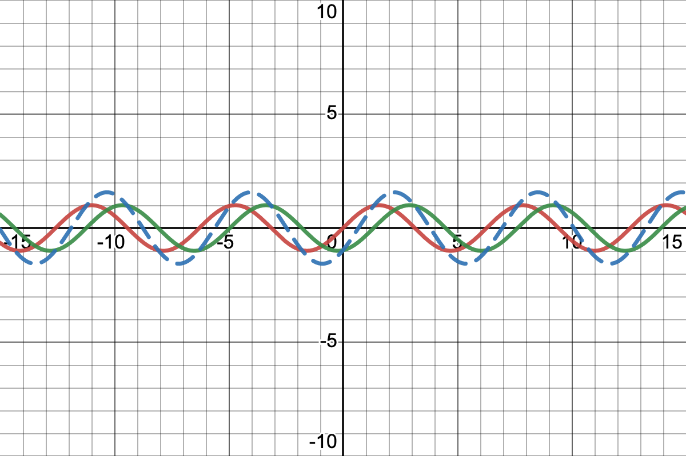
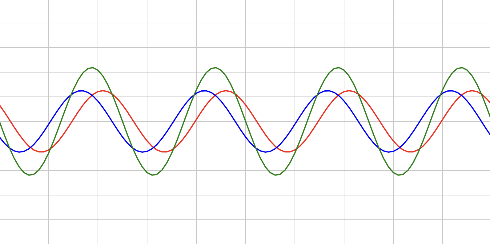
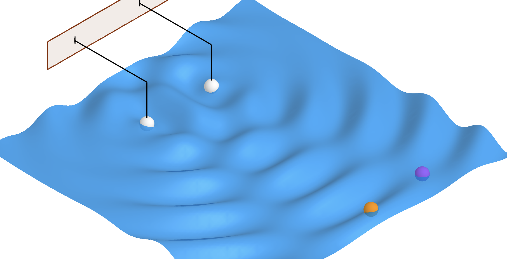

## Interferens
Interferens opstår, når to eller flere bølger mødes og kombineres for at skabe en ny bølge. Hvis bølgen bliver forstærket siges der at være **konstruktiv interferens**. Hvis bølgen bliver formindsket siges der at være **destruktiv interferens**.

### Simulering af interferens.
Simuleringen viser tre bølger. Den stiblede er summen af den  grønne og den røde. 

$$stiplet = grøn + rød $$

[link: Interferens](https://www.desmos.com/calculator/av4cypshx9)

### Øvelse
Forestil jer at vi har tiden ud af x aksensen.

* Beskriv hvordan den stiplede bølge ændrer sig når du flytter på den grønne kurve.
* Hvornår er det **konstruktiv interferens**?
* Hvornår er der **destruktiv interferens**?

### Simulering af stående bølge

### Øvelse
Forestil jer at den blå og den røde bølge er bølger på en guitar-streng som bevæger sig frem og tilbage langs strengen. Den grønne er summen af de to bølger.

* Forklar hvorfor det hedder en stående bølge.
* Lav om på den relative frekvens så den blå bølge ikke har samme frekvens som den røde. Hvad sker der med den grønne bølge?

### Bølger i to dimensioner
Hvis man ser på bølger i vand udbreder de sig i to dimensioner, $x$ og $y$. Hvis man laver to kilder til bølger får man steder med konstruktiv og destruktiv interferens. 

### Øvelse

* Forklar bevægelsen af den orange og den lilla bold. 

