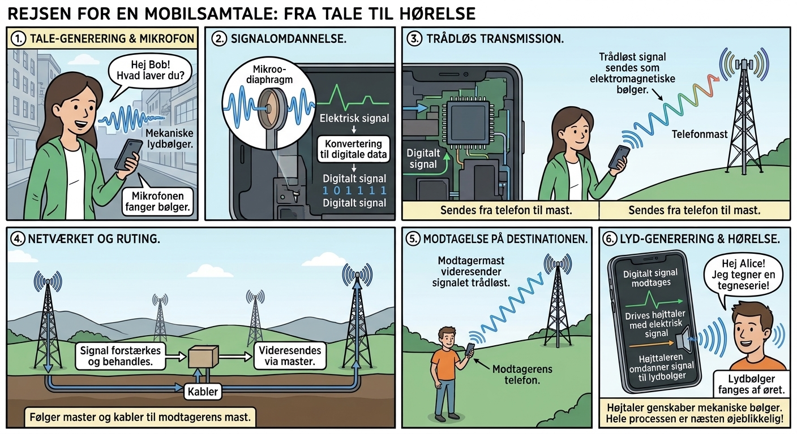
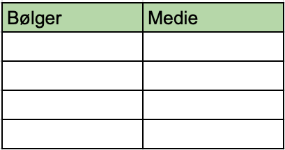

<link rel="stylesheet" href="../style.css">

##  En person taler i en mobiltelefon

Tegneserien viser hvordan informationen bliver sendt fra en person til en anden.

### Øvelse, bølgers udbredelse

* Beskriv hvordan beskeden fra pigen kommer frem til drengen.
* Find ud af hvilke billeder der indeholder bølger.

* Hvad er det som bevæger sig når pigen skaber bølger og når drengen hører lyden?
* Hvad er det som bevæger sig i ledningerne og inde i mobiltelefonen?

* Match bølgetyperne og det de bruger til at bevæge sig, mediet.

**lydbølger**, **elektrisk signal i mobiltelefonen**, **Wifi**, **elektriske signal i kablerne**

**elektroner**, **intet medie**, **elektroner**, **luftmolekyler**

