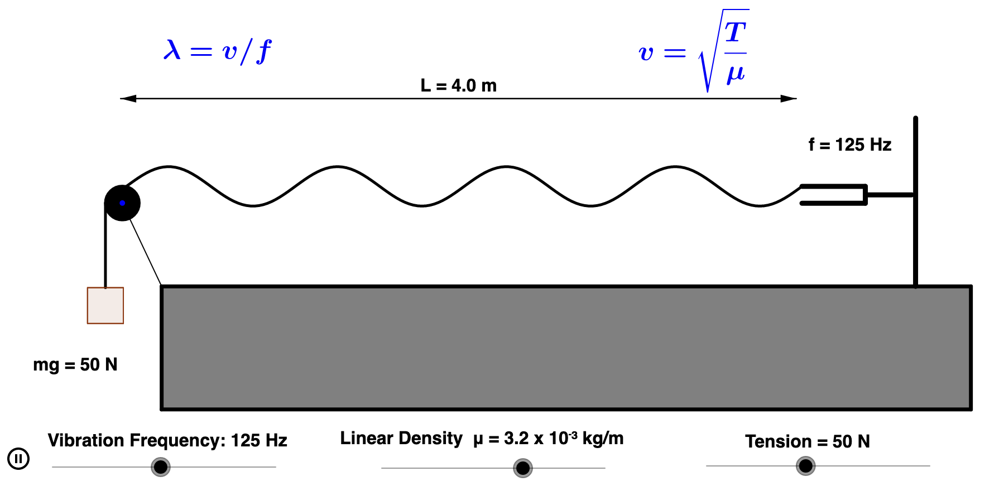
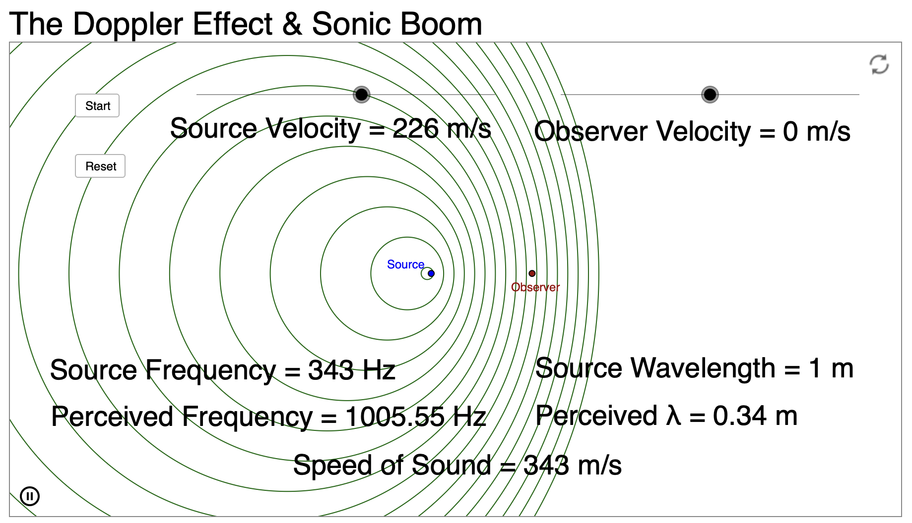

# noter bølger

## Læringsmål
* Kende begreberne: periode, bølgelængde, frekvens, hastighed, longitudinal, transversal, interferens, tonehøjde, klang, dopplerforskydning.
* Formler: $T = 1/f$, $v = \lambda \cdot f$.

## Eksperimenter

* Bestemmelse af lydens hastighed, 1 modul. duck://player/X5j_punYrUQ
* Slinki bølgetyper, 30 min.
* Den menneskelige stemme, 1 modul. 

### Virtuelle
* Simulering af bølgelængde og frekvens, 30 min.
* Interferens i kar, 30 min.

# forløbsplan, lektioner 90 min

1. Introduktion, periode.
2. periode, frekvens, bølgelængde og hastighed
    - demoforsøg, stemmegafler og perioden.
    - tonehøjde.
    - video med højtaler.
    - Simulering og øvelse med bølge.
3. Eksperiment med lydens hastighed.
    - opsamling på transversal og longitudinale bølger.
    - repetition af lydens hastighed.
4. Interferens.
    - Øvelse med slinky, ikke eksperiment.
    - eksempel, desmos
    - simulering med vandkar, øvelse.
    - Demoforsøg med højttalere.
    - Resonans - takoma bridge, guitar, fløjte.
5. Tonehøjde og klang, 
    - introduktion til vernier Graphical analysis, mål stemmegaffel og find perioden.
    - Beregn bølgelængden for bastoner og for diskant.
    - Demoforsøg: tonehøjde og hørelse.
    - eksperiment, den menneskelige stemme.
6. Opsamling
    - doppler

eksperiment med skridt og hastighed 1.b mangler.

1.c makkerskabsgrupper
Bord 1: (Terkel + Viggo) og (Max + Aske)

Bord 2: (Sif + Marius) og (Ava + Louis)

Bord 3:  (Liam, Aksel) og (Bertil + Frida)

Bord 4: (Mary + Vito + OttoT) og (Karla + Esther)

Bord 5: (Kiki + Vilma) og (Karen + Tara)

Bord 6: (Otto H + Margareta) og (Wilder + Benjamin)

Bord 7: (Ophelia + Mynthe) og ( Karl + Theodor)

Lydens hastighed duck://player/5_PLmKXod3E
Doppler: duck://player/HecqxJeM_K8

[Simulering af stående bølger](http://ophysics.com/waves6.html)

[Stående bølge på streng](http://ophysics.com/waves9.html)

# Doppler effekten

### Øvelse

Sæt Source velocity = 0 og Oberver velocity = 0, 
* forklar hvad I ser?

Sæt Source velovity = 90 m/s,
* forklar forskellen i den bølgelængde observeren modtager når 

Source er på vej hen mod Observer og på vej væk.
* Forøg Source Velocity og forklar hvad der sker.

Sæt Source velocity = 0 og Obsever velocity forskelligt fra nul
* Hvordan opfatter observer denne situation?

Fysiske størrelser når en tone skal beskrives:

* $f$, Frekvensen, hvor mange gange den svinger hvert sekund, enhed hertz, Hz.
* $T$, Perioden, hvor lang tid der går mellem hver bølge, enhed sekund, s.
* $\lambda$ lambda, Bølgelængde, hvor langt der er mellem hver bølge, enhed meter, m.
* $v$, Fart, hvor hurtigt bølgen bevæger sig, enhed m/s.

Sammenhængen mellem perioden og frekvensen er
$f = \frac{1}{T}$